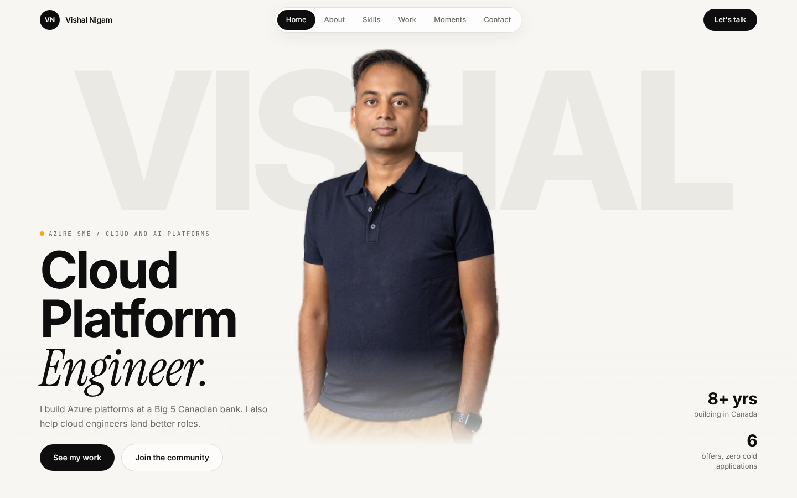

# Cloud Portfolio Template

A clean, black and white portfolio for **Cloud, DevOps, SRE, and Platform engineers**.
Free to use. Live on GitHub Pages in about 15 minutes.



**What you get**

- **Animated hero.** A cartoon version of you, standing center screen, with your name huge behind you. It can wave and talk in your voice.
- **Flipping ID badge** on a lanyard. Tap to flip, drag to swing.
- **Experience timeline** with every role, highlights, tools, earlier career and education.
- **Periodic table of your tools.** Filter by Cloud, IaC, Containers, CI/CD, and more.
- **Certifications, projects, and "proud moments"** that scroll sideways.
- Smooth scrolling, phone friendly, and fast.
- **One file to edit.** Every word on the site lives in `src/portfolio.config.ts`.
- **Resume in, website out.** Give Claude your resume and it fills the whole site for you.

Built with React, Vite, Tailwind CSS, Framer Motion, and Lenis.

---

## Two ways to build it

| | By hand | With Claude |
|---|---|---|
| How | Edit one file on GitHub | Give Claude your resume |
| Time | About 30 minutes | About 10 minutes |
| Best for | You like full control | You want it done fast, with your full work history |

Both start the same way: steps 1 and 2 below.

---

## Get it live in 4 steps (no coding needed)

### 1. Make your copy
Click the green **Use this template** button at the top of this page, then **Create a new repository**.

Name it `your-github-username.github.io` and your site will live at
`https://your-github-username.github.io`.
Any other name works too. Your site will be at `https://your-github-username.github.io/repo-name/`.

### 2. Turn on GitHub Pages
In your new repo: **Settings > Pages > Source > GitHub Actions**.

Do this before your first edit. If Source stays on "Deploy from a branch", your site shows raw code instead of the finished page.

### 3. Add your details
- Open `src/portfolio.config.ts` and click the pencil icon to edit it right on GitHub.
- Replace every example with your own info. Titles accept `*word*` to make a word italic serif.
- Upload your files: open `public/media`, then **Add file > Upload files**.
  - Your hero image or video. See [Create your animated hero](#create-your-animated-hero) below.
  - `headshot.jpg`: a square headshot for the badge. Then set `badge.photo: 'media/headshot.jpg'`.
  - `resume.pdf`: optional.

### 4. Commit
Click **Commit changes**. Open the **Actions** tab and wait for the green tick (about 2 minutes).
Your site is live.

---

## Build it with Claude

Claude can read your resume and write every section of the site: your story, each role with its highlights, your skills table, certifications, projects and proud moments.
This repo includes a `CLAUDE.md` file that tells Claude exactly how to do it.

Pick the option that matches how you use Claude.

### Option A: Claude chat (no install)

Use this if you chat with Claude at [claude.ai](https://claude.ai) or in the Claude app.

1. Do **steps 1 and 2** above, so you have your own repo with Pages turned on.
2. In your repo, open `src/portfolio.config.ts` and click the **Download raw file** button (the down arrow, top right of the file).
3. Start a new chat with Claude. Attach **your resume** and the **portfolio.config.ts** file you downloaded.
4. Paste this prompt. Fill in the parts in [brackets], or delete the lines you don't need.

```
I'm building my portfolio website from the attached template config file.
Rewrite portfolio.config.ts completely using my attached resume.

Rules:
- Use only facts from my resume or from me. Do not invent employers, dates, numbers,
  certifications or results. If something is missing, ask me first.
- Keep the exact same structure and field names as the attached file.
- experience.jobs: every role from the last 10 to 12 years, newest first,
  2 to 6 highlights each, strongest first, written as plain active sentences.
  Older roles go in experience.earlier, degrees in experience.education.
- skills: 5 to 7 groups and 20 to 32 tools from my resume. Symbols are 1 or 2 letters
  and unique. Add a short note to my strongest tools.
- Titles use *asterisks* around one word for the italic accent.
- Do not include my phone number or home address anywhere.
- Hero image: [use 'media/hero.jpg' / leave empty for now].

Extra details:
- My links: LinkedIn [url], GitHub [url], other [url]
- Projects I'm proud of: [name, one line, link]
- Numbers I'm proud of: [for example: cut cloud cost 30%, led 6 engineers]
- My first name for the big hero text: [NAME]

Before you write the file, ask me about anything missing.
Then return the complete file in one code block, ready to paste.
```

5. Answer Claude's questions. Read the result and correct anything that isn't quite right. It's your name on it.
6. Back on GitHub, open `src/portfolio.config.ts`, click the **pencil** icon, select all, paste Claude's file, and **Commit changes**.
7. Wait about 2 minutes for the **Actions** tab to show a green tick. Your site is live.

If the Actions run fails, open it, copy the red error, and paste it to Claude. It will tell you exactly what to change.

### Option B: Claude Code (Claude does everything)

Use this if you have Claude Code, Anthropic's coding agent, or any Claude that can work with your files and GitHub.
See [docs.claude.com](https://docs.claude.com) for how to set it up.

1. Do **step 1** above to create your repo from this template.
2. Ask Claude to clone your repo, or open the cloned folder in Claude Code.
3. Put your resume in the `resume/` folder. That folder is private: git ignores everything in it, so your resume is never published.
4. Say:

```
Build my portfolio from my resume. Follow CLAUDE.md.
```

5. Claude reads your resume, asks for missing details like links and projects, fills the config, runs a build to check it, and pushes.
6. Want the animated hero too? Add a fal.ai key to a file called `.env` as `FAL_KEY=your-key` and say:

```
Now create my animated hero. Use Path 2 from the README. My photos are in resume/.
```

Claude shows you the cost before each step and asks before running it. `.env` is git-ignored, so your key stays private.

7. If Claude can't change the GitHub Pages setting for you, set **Settings > Pages > Source > GitHub Actions** yourself.

> **Tip for both options:** Claude writes from your resume, so a stronger resume makes a stronger site.
> Results you can measure (time saved, cost cut, users served) make the best highlights.

---

## Create your animated hero

Pick the path that suits you. Both use web tools only. No code, no command line.

| | Path 1: Animated image | Path 2: Talking animated video |
|---|---|---|
| What visitors see | A cartoon of you, gently floating | A cartoon of you that waves and talks in your voice |
| Time | About 15 minutes | About 45 minutes |
| Cost | About $0.15 to $0.60 | About $1 to $2 |
| Tools | fal.ai | fal.ai, plus your phone or ElevenLabs |

You can start with Path 1 today and upgrade to Path 2 later. Path 2 starts with the same image.

Prices are what the tools charged when this guide was written. They change often, so check each tool's pricing page before you run anything.

### Before you start
1. **Create a fal.ai account** at [fal.ai](https://fal.ai) and add a small amount of credit, about $5.
   fal runs the AI models. Every model page has a simple web form, called the playground, so you never touch code.
2. **Take two photos** in good light, against a plain wall:
   - **Full body**, standing straight, facing the camera, hands relaxed. Wear what you want your cartoon to wear.
   - **Headshot**, face clearly visible, looking at the camera.

---

### Path 1: Animated image (no video)

**Step 1. Turn your photos into a cartoon.**

1. Open the [Nano Banana Pro edit](https://fal.ai/models/fal-ai/nano-banana-pro/edit) model page on fal.ai.
2. Upload both photos: full body first, headshot second.
3. Paste this prompt. Replace the part in [brackets] with your outfit.

```
Turn the person in the first photo into a stylized 3D animated character, like a modern
animated feature film. Use the second photo for the face. Keep the likeness clearly
recognizable: same face shape, hairline, skin tone, eye color and friendly expression.
Same outfit: [for example: navy polo shirt, khaki chinos, black smartwatch].
Full body, standing upright, centered, facing the camera, relaxed confident pose,
hands loosely in pockets. Slightly stylized proportions, soft clean shading,
appealing and professional, not childish.
Background: plain pure white (#FFFFFF), seamless, no floor line, no shadow on the
background, only a very soft contact shadow under the feet.
No text, no logos, no props.
```

4. Set these options:
   - **Aspect ratio:** `3:4`
   - **Resolution:** `2K`
   - **Output format:** `JPEG`
   - **Number of images:** 2 to 4, so you can pick the best one.
5. Click **Run**. Each image costs about $0.15. Download the one that looks most like you.

> Not quite right? Run it again and add one fix to the end of the prompt, such as
> "make the hairline match the photo" or "add his glasses".

**Step 2. Add it to your site.**

1. Rename the file to `hero.jpg` and upload it to `public/media`.
2. In `src/portfolio.config.ts`, set:

```ts
video: '',
poster: 'media/hero.jpg',
```

3. Commit. Done.

**Why JPEG?** The site automatically blends a white background into the page, so your name shows around you. It does this for `.jpg` images and `.mp4` videos.
If you remove the background yourself and save a transparent `.png`, that works too. Just point `poster` at the `.png`.

---

### Path 2: Talking animated video

You need the cartoon from **Path 1, Step 1** first. Keep that image file.

**Step 1. Record your voice line.**

Keep it short, about 8 seconds. Here is a script you can adapt:

```
Hi, I'm [your name]. I build [what you build, for example: cloud platforms on AWS].
Scroll down, let me show you.
```

Choose one:

- **Your phone (free).** Record in a quiet room with the phone about 20 cm from your mouth. iPhone Voice Memos (`.m4a`) and Android recorder files both work.
- **An AI voice clone ([ElevenLabs](https://elevenlabs.io)).** Clone your voice once, then type the script and download it as MP3. Voice cloning usually needs a paid plan, so check their pricing first.

**Step 2. Make your cartoon talk.**

1. Open the [Kling AI Avatar v2 Pro](https://fal.ai/models/fal-ai/kling-video/ai-avatar/v2/pro) model page on fal.ai.
2. **Image:** upload your cartoon from Path 1.
3. **Audio:** upload your voice recording.
4. **Prompt:** paste this.

```
The animated character stands centered on a pure white background and talks warmly to
the camera. A small friendly wave at the start, then relaxed natural hand gestures
while speaking. Static camera, no zoom, no cuts. The background stays pure white.
```

5. Click **Run**. It takes about 3 to 5 minutes and costs about $0.12 per second of audio, so roughly $1 for 8 seconds.
6. Watch the result. If the lip sync or motion looks off, run it once more. Each run comes out a little different.
7. Download the video.

**Step 3. Add it to your site.**

1. Rename the video to `hero.mp4` and upload it to `public/media`.
2. Also upload your cartoon image as `hero.jpg`. Visitors see it while the video loads.
3. In `src/portfolio.config.ts`, set:

```ts
video: 'media/hero.mp4',
poster: 'media/hero.jpg',
```

4. Commit. Done.

The video plays muted, because browsers block autoplay with sound. Visitors tap **"Tap for sound"** to hear you.

> **GitHub upload limit:** the web uploader takes files up to 25 MB. An 8-second avatar video is
> usually 3 to 5 MB, so this is rarely a problem.

---

### Optional extras for Path 2

These are for people comfortable with the command line. Your site works fine without them.

**Smaller file.** If you have [ffmpeg](https://ffmpeg.org) installed, this shrinks the video to well under 1 MB, so it loads faster on phones:

```bash
ffmpeg -i hero.mp4 -vf "scale=-2:1280" -c:v libx264 -crf 25 -preset slow -c:a aac -b:a 96k -movflags +faststart hero-small.mp4
```

**A truly transparent version.** The `.mp4` blend looks great almost everywhere. For a perfect edge in Chrome, Edge, Firefox and Android, add a transparent `.webm`. Safari and iPhone keep using the `.mp4` automatically.

```bash
ffmpeg -i hero.mp4 -filter_complex "[0:v]colorlevels=rimax=0.965:gimax=0.965:bimax=0.965,scale=-2:1280,format=rgba,colorkey=0xFFFFFF:0.10:0.08,format=yuva420p[v]" -map "[v]" -map 0:a -c:v libvpx-vp9 -pix_fmt yuva420p -b:v 0 -crf 34 -auto-alt-ref 0 -c:a libopus hero.webm
```

Upload `hero.webm` to `public/media`, then add this line next to `video` in the config:

```ts
videoTransparent: 'media/hero.webm',
```

**Trim the empty space.** If you look small on the page, crop the extra white space around you. Most online video croppers work. Keep the full height, from the top of your head to your feet.

---

### Hero troubleshooting

| Problem | Fix |
|---|---|
| A white box shows around me | Your file is `.png` with a white background. Save it as `.jpg` instead, or remove the background. |
| My name doesn't show behind me | Check that `backdropWord` in the config is set. |
| The cartoon doesn't look like me | Use a sharper headshot. Add one specific fix to the prompt and run again. |
| fal says the image can't be processed | Some models refuse real photos. Make the cartoon first (Path 1), then animate the cartoon. |
| The video won't play on iPhone | Make sure the file is `.mp4`. iPhone can't play `.webm`. |
| My site shows raw code | Settings > Pages > Source must be **GitHub Actions**. |

---

## Run it on your computer (optional)
You need Node.js 20 or newer.

```bash
npm install
npm run dev
```

Open the link it prints. Every save to the config updates the page instantly.

## Deploy to Azure instead (optional)
Good practice if you're building your Azure portfolio.

1. Azure Portal > **Create a resource > Static Web App** (the Free plan is enough).
2. Source: **GitHub**. Pick your repo and the `main` branch.
3. Build presets: **Custom**. App location: `/`. Output location: `dist`.
4. Azure adds its own workflow file to your repo and deploys.

If you use Azure only, delete `.github/workflows/deploy.yml` so GitHub Pages doesn't also try to run.

## Customize

| I want to... | Do this in `portfolio.config.ts` |
|---|---|
| Change the accent color | `site.accent` |
| Hide certifications | `certifications: []` |
| Add a skill column | add to `skills.groups`, then add elements with that `group` |
| Remove the footer credit | `site.showCredit: false` |

Want deeper changes? Each section is its own file in `src/components`.

---

## Credits
Template by **Vishal Nigam**, Azure SME and mentor for cloud engineers.
[LinkedIn](https://www.linkedin.com/in/nigam-vishal) · [Instagram @thrivewithvishal](https://www.instagram.com/thrivewithvishal/)

The demo hero was made with exactly this guide: Path 2, using an ElevenLabs voice clone.

The footer link back here is optional. If this helped you, keeping it is a nice thank-you.

Released under the MIT License. Use it, change it, ship it.
